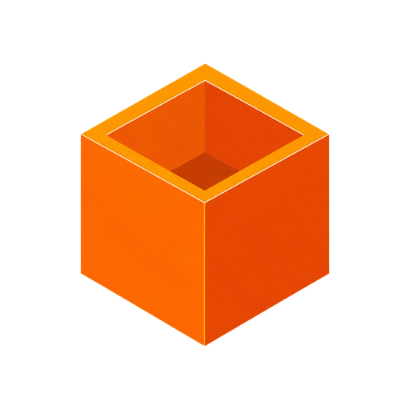

# BlockoutGames/.github

**The organisation's public face and its defaults.** 
The profile on [github.com/BlockoutGames](https://github.com/BlockoutGames), and the community files
every repository inherits.

 

## What lives here

| Path                        | What it does                                                                                     |
| --------------------------- | ------------------------------------------------------------------------------------------------ |
| `profile/README.md`         | The organisation's profile page, shown to everyone at github.com/BlockoutGames                   |
| `assets/`                   | The banner (dark and light) and the cube mark the profile shows                                  |
| `SECURITY.md`               | How to report an exploit or vulnerability privately; shown on every repository's Security tab   |
| `SUPPORT.md`                | Where players and developers go for help                                                         |
| `CONTRIBUTING.md`           | Branches, commits, pull requests and the rules that do not bend                                  |
| `CODE_OF_CONDUCT.md`        | How we treat each other and our players                                                          |
| `ISSUE_TEMPLATE/`           | Bug and task forms, and links to security and support                                            |
| `PULL_REQUEST_TEMPLATE.md`  | The sections every pull request fills                                                            |

## How inheritance works

GitHub uses a file from this repository for **any repository in the organisation that does not
have its own**. A repository's own file always wins: the platform keeps its own issue templates,
the game template keeps its own pull request template, and so on. Delete a repository's copy and
it falls back to the one here.

The issue forms and pull request template here are deliberately general, so a new game gets
sensible defaults on day one. Anything specific to one codebase belongs in that repository.

## Editing the profile

- Keep it about **players and the studio**. The profile is public; nothing internal (tools,
  numbers, plans, people's private details) goes here.
- Images live in `assets/` and are linked relatively (`../assets/...`).
- The banner is SVG so it stays sharp. `banner-light.svg` is `banner-dark.svg` with the light
  palette: change both together. The cube in it is drawn from `BlockoutGames_Transparent.png`.
- Check the page in both GitHub themes before merging.

## Brand

| Use        | Value     |
| ---------- | --------- |
| Brand      | `#f97316` |
| Dark       | `#0a0a0a` |
| Light      | `#fafafa` |
| Muted      | `#a3a3a3` |

The cube mark, the wordmark and the name "Blockout Games" are trademarks of Blockout Games.
They may be used only as the template's licence allows.

 

Blockout Games is not affiliated with Roblox Corporation.

