<picture>
  <source media="(prefers-color-scheme: dark)" srcset="../assets/banner-dark.svg">
  <source media="(prefers-color-scheme: light)" srcset="../assets/banner-light.svg">
  
</picture>

 

[**Website**](https://www.blockoutgames.com) ·
[**Roblox community**](https://www.roblox.com/communities/191769851/Blockout-Games) ·
[**The team**](#-the-team) ·
[**Get in touch**](#-get-in-touch)

 

**A new world. A good challenge. A reason to come back.** We make games you want to keep playing.

Blockout Games is a small, independent Roblox studio built around one simple idea: make something
that feels good to play. We bring ideas to life, play them together, and keep making them better.

 

## 🧱 How we work

|     | Play comes first                                                                                                  |
| :-: | ----------------------------------------------------------------------------------------------------------------- |
| 01  | **Start with the fun.** A great game starts with a moment you want to experience again. Build around that moment. |
| 02  | **Make it together.** Bring different ideas to the same table. Give each project the people and attention it needs. |
| 03  | **Keep getting better.** Play, listen, and iterate. There is always another detail that can make it feel better.  |

 

## 🛠️ How we build

Every Blockout game starts from the same foundation: a game that already runs on day one, so each
new project spends its time on what makes it fun.

- 🛡️ **Fair by design.** The server decides everything that matters: currency, damage, prices,
  positions. A server-side anti-cheat watches for speed, flight, teleports and remote abuse.
- 📱 **Every device.** One interface, scaled for phone, tablet, PC, console and VR, with touch,
  gamepad and keyboard all first-class.
- 🧪 **Tested outside Studio.** Strict Luau, unit tests that run in under a second, and the same
  checks in CI on every pull request.
- 🧡 **Powered by Blockout Games.** Every game built on our template carries it on its loading screen.

  
  
  
  
  
  
  

 

## 👋 The team

<table>
  <tr>
    <td align="center" width="160">
      <a href="https://github.com/isaacwallace123">
         
        <b>Isaac</b>
      </a> 
      @isaacwallace123
    </td>
    <td align="center" width="160">
      <a href="https://github.com/Reid910">
         
        <b>Sam</b>
      </a> 
      @Reid910
    </td>
    <td align="center" width="160">
      <a href="https://github.com/ChiefNorth">
         
        <b>Noah</b>
      </a> 
      @ChiefNorth
    </td>
    <td align="center" width="160">
      <a href="https://github.com/CaidenSteele05">
         
        <b>Caiden</b>
      </a> 
      @CaidenSteele05
    </td>
    <td align="center" width="160">
      <a href="https://github.com/NathanRoos">
         
        <b>Nathan</b>
      </a> 
      @NathanRoos
    </td>
  </tr>
</table>

Small team, big imagination.

 

## 📬 Get in touch

|                            |                                                                                                                       |
| -------------------------- | --------------------------------------------------------------------------------------------------------------------- |
| 🎮 **Playing our games?**   | Help, bugs and purchases: [Support](https://github.com/BlockoutGames/.github/blob/main/SUPPORT.md)                     |
| 🛡️ **Found an exploit?**    | Report it privately, never in public: [Security](https://github.com/BlockoutGames/.github/blob/main/SECURITY.md)       |
| 🤝 **Want to work with us?** | Partnerships and everything else: [www.blockoutgames.com](https://www.blockoutgames.com)                              |

 

Block by block. Game by game. Blockout Games is not affiliated with Roblox Corporation.

